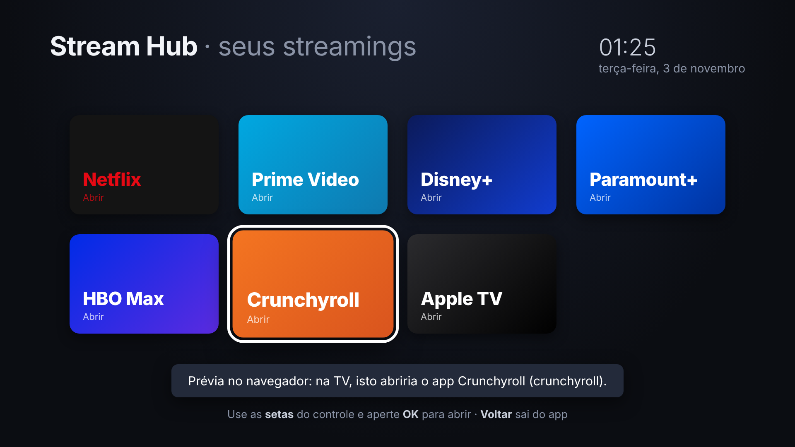

# Stream Hub para TV LG (webOS)



Uma tela inicial única para os seus streamings: **Netflix, Prime Video, Disney+, Paramount+,
HBO Max, Crunchyroll e Apple TV**. Você navega com as setas do controle e aperta **OK**. O hub
abre o app oficial do serviço já logado na sua conta.

## Por que o login fica nos apps oficiais

Nenhum app de terceiros consegue fazer login nesses serviços nem reproduzir o conteúdo deles
dentro de si. Os vídeos têm proteção DRM e os serviços bloqueiam isso. Então funciona assim:

1. Instale cada app oficial pela **LG Content Store** e faça login **uma vez** em cada um.
2. Depois disso, use o Stream Hub como a sua tela de streamings. Ele abre cada app já logado.

## Instalar na TV (modo desenvolvedor, gratuito)

Você precisa de um computador (Windows, Mac ou Linux) com Node.js na **mesma rede Wi-Fi** da TV.

1. Crie uma conta em <https://webostv.developer.lge.com> (é grátis).
2. Na TV, instale o app **Developer Mode** pela LG Content Store, entre com essa conta e
   ative **Dev Mode Status** e **Key Server**. A TV reinicia. Anote o IP que aparece no app.
3. No computador, instale a ferramenta de linha de comando da LG:
   ```bash
   npm install -g @webos-tools/cli
   ```
4. Cadastre a TV (escolha *add*, informe o IP e use a porta 9922):
   ```bash
   ares-setup-device
   ares-novacom --device tv --getkey   # pede a passphrase mostrada no app Developer Mode
   ```
5. Empacote e instale, a partir da pasta acima de `lg-tv-hub`:
   ```bash
   ares-package lg-tv-hub
   ares-install --device tv com.briam.streamhub_1.0.0_all.ipk
   ares-launch --device tv com.briam.streamhub
   ```

O **Stream Hub** aparece na lista de apps da TV. Fixe-o no início da barra inicial.

> O modo desenvolvedor expira em **50 horas**. Abra o app *Developer Mode* e aperte
> **Extend** de vez em quando para não perder o app instalado.

## Se algum serviço não abrir

O ID interno de cada app muda conforme o país e a versão do webOS. O hub tenta vários IDs
conhecidos, mas se aparecer "não está instalado" para um app que você **tem**, descubra o
ID certo e acrescente no início da lista `ids` do serviço, no `index.html`:

```bash
ares-launch --device tv --running        # com o app aberto na TV, mostra o ID dele
```

Depois rode `ares-package` e `ares-install` de novo.

## Testar no computador

Abra `index.html` no navegador. Ele funciona em modo de prévia: dá para navegar com as setas e
ver qual app seria aberto.

## Arquivos

| Arquivo | O que é |
|---|---|
| `appinfo.json` | Manifesto do app webOS (ID, nome, ícones) |
| `index.html` | Interface, navegação pelo controle e lista de serviços |
| `icon.png`, `largeIcon.png` | Ícones de 80 px e 130 px |
